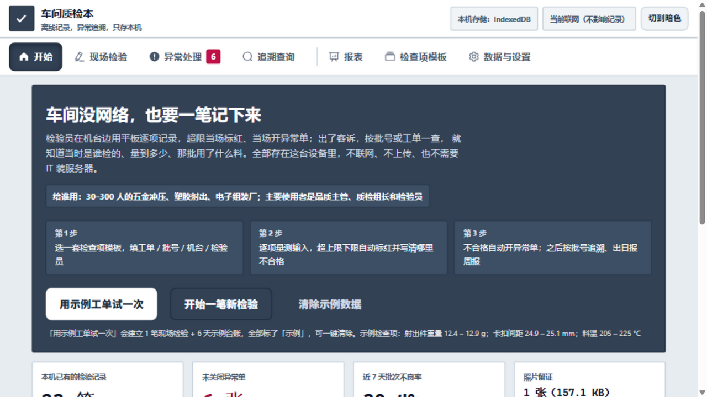
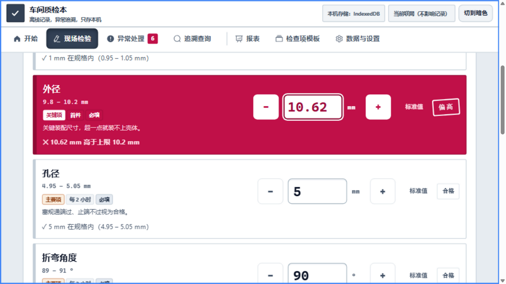
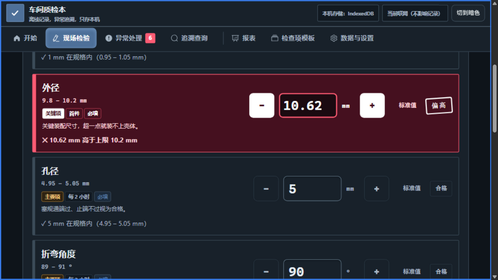

<div align="center">


# 车间质检本 Shopfloor QC

**给五金冲压、塑胶射出、电子组装等中小制造厂的检验员：在没有网络的车间机台边逐笔记录，超限当场判定并开异常单；出了客诉，按批号查得到当时是谁检的、量到多少、那批用了什么料。**

[](https://gillion888-acl.github.io/shopfloor-qc/)


</div>

---

## 概述

车间质检本是一个**纯前端、纯本机**的质检记录工具：检验员在机台边用平板逐项量测记录，超上下限立即可见并当场开异常单；数据全部落在本机浏览器里，不需要服务器、数据库、账号或网络。交付物就是一个静态目录，拷到任意能访问的位置即可运行。

| 项目 | 说明 |
|---|---|
| 给谁用 | 30–300 人、有专职品质人员、车间网络不稳定或没有网络的中小加工厂 |
| 谁在用 | 检验员、质检组长（机台边用平板单手操作）；品质主管、厂长（看报表、追责、应对客户查验） |
| 运行环境 | 一台平板或电脑 + 一份静态文件目录；无服务器、无数据库、无 IT 部署 |
| 解决什么 | 纸质记录会丢、事后补录不可信、客诉时拿不出当时那一批的原始记录 |
| 不做什么 | 不做云端与多厂区汇总看板，不做设备联网采集；只做车间端的记录、判定与追溯 |

### 已知限制

- **没有 Service Worker。** 这里的「离线」指没有互联网连接：所有依赖都是本机文件，不加载 CDN、不发统计。但页面本身没有本地缓存兜底，**如果托管页面的主机不可达，重新载入页面会失败**。现场建议开一次不关，或把同一份目录部署在本机可访问的机器上。
- **必须以静态服务打开，不能双击 `file://`。** 项目使用 ES Modules 并通过 `fetch` 读取同目录的 `templates.json`，`file://` 协议下会被浏览器安全策略拦截。

## 功能特性

### 检查项模板

- 每个检查项可定义：名称、类型（数值上下限 / 是-否 / 选项 / 文字）、单位、上下限、是否必填、抽样频率、**严重度**（关键 / 主要 / 次要）、现场提示语。
- 内置三套示例模板：**五金冲压 · 首件与巡检**、**塑胶射出 · 首件与过程巡检**、**电子组装 · 功能测试与外观**。首次打开时写入本机库，之后归使用者所有，可直接改。
- 支持新增模板、增删检查项、上下移动排序，导出 / 导入 JSON。
- 判定所需规格随记录一起落库：模板日后被修改，历史记录仍按当时的规格解释。

### 离线逐笔记录

- 记录头：工单、批号、机台、检验员、班别、批量；连续检验时自动沿用上一笔的工单 / 机台 / 检验员，一笔在 30 秒内录完。
- 现场优先的录入方式：数字键盘直接弹出（`inputmode="decimal"`）、回车跳下一项、`+` / `-` 微调、一键填标准值。
- **不合格项整行反白并放大读数**，同时写明原因（例：`10.62 mm 高于上限 10.2 mm`），便于现场识别。
- 判定口径：上下限为闭区间（等于限值算合格）；单边规格按 `≤ 上限` / `≥ 下限`；是-否项按「合格答案」判定；文字项由人下结论。空白视为未填、乱填视为填错，两者都不算合格。
- **照片留证在本机压缩**：最长边 1280、JPEG，压缩后才落库，不上传。压缩后仍超出当前存储方式的照片预算时会拒绝写入并说明原因。

### 异常处理闭环

- 不合格保存时自动弹出开单；当时选择「先不开单」的记录会留在「不合格但没开异常单」清单里，品质主管可补开。
- 分级规则透明（见下表），系统给出建议等级，**最终由人确认**。
- 记录处置人、开单时间与关闭时间；**关闭异常单必须写明处理结果**，否则不予关闭。
- 超过 24 小时未关闭的异常单自动标红，报表中提供「未关闭异常清单」用于催办。

| 情况 | 建议等级 |
|---|---|
| 关键项不合格 | 报废 |
| 主要项不合格，且偏离规格带 ≥ 50% | 报废 |
| 主要项不合格 | 隔离（先挂标识待判定） |
| 只剩次要项不合格 | 返工 |
| 让步接收 | **系统永不自动选择**，必须品质主管核准并写明理由 |

### 追溯查询

- 任一条件即可查询，也可叠加：批号 / 工单 / 机台 / 检验员 / 日期区间 / 结论 / 异常等级 / 关键字。
- 关键字会同时检索不合格项名称、实测值、备注，以及异常单的处理经过与处置人 —— 只知道不良现象也能翻出是哪一批。
- 查询结果可展开查看完整记录（逐项规格、实测值、判定）与留证照片。
- 「客户投诉 → 该查哪一项」：把投诉原话粘进来，用离线关键词规则归类到对应检查项，再一键跳到追溯查询。

### 报表与导出

- 日报 / 周报 / 月报：检验批次、批次不良率、项次不良率、Top 不良项、异常分级分布、按检验员统计、未关闭异常清单，并与上一区间对比。
- 图表为手写 SVG，不引入图表库；样式带 `@media print`，可直接打印或存为 PDF。
- 导出能力：Markdown（贴进工作群）、CSV（一行一笔 / 一行一项 / 异常单）、JSON 全量备份（可导入还原）、模板 JSON。
- CSV 带 UTF-8 BOM，用电子表格软件直接打开中文不乱码；是-否项导出为中文，未填写导出为「—」。

## 界面预览

<table>
  <tr>
    <td width="50%" align="center">
      <br />
      <sub>现场检验：不合格项整行反白、放大读数，并写明超差原因</sub>
    </td>
    <td width="50%" align="center">
      <br />
      <sub>暗色主题：同一界面的暗色配色，适合夜班或弱光车间</sub>
    </td>
  </tr>
</table>

页首截图是「开始」页：本机存储方式、联网状态、三步流程、示例数据入口与四项当日概览。

## 快速开始

不需要 `npm install`，也不需要构建工具，运行环境只需 Node ≥ 20（仅用于启动本地服务与跑测试）。

```bash
node serve.mjs      # 启动本地静态服务 → http://localhost:4220
node --test         # 运行全部单元测试（78 个）
```

打开 `http://localhost:4220` 后，点 **【用示例工单试一次】**：会建立 1 笔现场检验（走与人工完全相同的保存路径）+ 6 天示例台账，全部标记「示例」，可一键清除。想先看效果也可以直接访问[在线体验](https://gillion888-acl.github.io/shopfloor-qc/)。

需要现场排查「这台平板存不进去」时，可以强制指定存储方式：

| 地址 | 效果 |
|---|---|
| `http://localhost:4220/` | 正常：IndexedDB（可存照片，容量最大） |
| `http://localhost:4220/?storage=local` | 强制只用 localStorage（记录存 JSON、照片存 dataURL，照片预算降到 2 MB） |
| `http://localhost:4220/?storage=memory` | 强制只用内存，界面会亮出「一刷新就没了」的红色警告 |

根目录的 `sample-photo.png` 是**程序生成的示例照片**（不是真实客户照片），用于验证「拍照 / 选照片」这条链路：拖进录入界面后会在本机压缩再落库。

## 使用流程

1. **准备模板** —— 在「检查项模板」页选一套内置模板直接改，或新建一套：按厂里现成的检验表填名称、类型、上下限、抽样频率与严重度，导出 JSON 留档。
2. **开一笔检验** —— 「现场检验」页填写工单、批号、机台、检验员、班别与批量；连续检验时上一笔的头信息会自动带过来。
3. **逐项录入** —— 每项录入实测值（数值项可用 `+` / `-` 微调），系统即时判定；不合格项整行反白并写明超差方向；需要留证就拍照或选图，照片在本机压缩后随记录保存。
4. **异常闭环** —— 保存时若存在超限项，自动弹出开单对话框：确认建议等级、指定处置人；处置完成后再回到「异常处理」页填写处理结果并关闭。
5. **看报表** —— 收班或交班前打开「报表」，切日报 / 周报 / 月报看批次量、不良率、Top 不良项与未关闭异常，导出 Markdown 贴群或打印存档。
6. **追溯与移交** —— 客诉发生时到「追溯查询」按批号或关键字定位那一笔，看当时的规格、实测值与照片；换设备或清理前，先到「数据与设置」导出 JSON 全量备份。

## 技术栈

| 层次 | 选型 | 版本 | 说明 |
|---|---|---|---|
| 界面框架 | Vue 3（全局构建） | 3.5.13 | 本地内嵌 `vue.global.prod.js`，不引用 CDN |
| UI 组件 | Element Plus | 2.9.1 | 本地内嵌 JS 与样式；图标包 2.3.1 |
| 语言与模块 | 原生 JavaScript + ES Modules | — | 无编译器、无打包器、无运行时依赖 |
| 领域逻辑 | `qc.js` | — | 纯函数：判定、分级、追溯、报表、CSV / Markdown、离线归类 |
| 存储层 | `store.js` | — | 驱动与仓库分离：IndexedDB → localStorage → 内存 三级降级 |
| 数据落盘 | IndexedDB（照片存 Blob）/ localStorage（JSON + dataURL）/ 内存 | — | 照片预算：512 MB / 2 MB / 24 MB |
| 样式 | 手写 CSS（自定义属性 + 亮 / 暗双主题 + `@media print`） | — | 大按钮、大字号、窄屏与平板自适应 |
| 图表 | 手写 SVG + CSS | — | 不引入图表库 |
| 测试 | Node 内置 `node:test` | Node ≥ 20 | 78 个单元测试，覆盖判定、分级、追溯、报表、存储降级 |

## 目录结构

全部文件平铺在根目录，没有子目录依赖，路径全部是相对路径。

```
shopfloor-qc/
├── index.html                     页面外壳
├── app.js                         界面与交互（Vue 3，含全部视图）
├── qc.js                          领域逻辑：判定 / 分级 / 追溯 / 报表 / 示例台账
├── store.js                       本机存储：IndexedDB → localStorage → 内存 三级降级
├── styles.css                     主题：亮色 / 暗色 / 打印 / 窄屏
├── templates.json                 三套内置示例检查项模板
├── qc.test.mjs                    领域逻辑单元测试
├── store.test.mjs                 存储层单元测试
├── serve.mjs                      本地静态服务（仅用于预览，端口 4220）
├── sample-photo.png               程序生成的示例照片（验证拍照与压缩链路）
├── screenshot-1-home.png          截图：开始页
├── screenshot-2-inspect.png       截图：现场检验
├── screenshot-3-dark.png          截图：暗色主题
├── vue.global.prod.js             内嵌依赖：Vue 3
├── element-plus.full.min.js       内嵌依赖：Element Plus
├── element-plus.css               内嵌依赖：Element Plus 样式
├── element-plus-icons.iife.min.js 内嵌依赖：Element Plus 图标
├── README.md                      本文件
├── LICENSE                        MIT 许可证
├── THIRD-PARTY.md                 内嵌第三方依赖清单与授权
├── package.json                   仅 `test` / `serve` 两个脚本，无运行时依赖
└── .nojekyll                      静态托管用：跳过 Jekyll 处理
```

## 部署

1. **整目录拷贝即可。** 把本目录完整复制到任意静态空间：内网目录、NAS、U 盘、对象存储或静态托管，不需要任何服务端代码。
2. **可以放在子路径下。** 页面内所有引用都是相对路径（`./`），放在 `https://example.com/qc/` 这类子目录同样可用。
3. **必须用静态服务打开。** 不能双击 `index.html`（`file://`），原因见上方「已知限制」。
4. **托管到 GitHub Pages。** 把目录内容推送到仓库并启用 Pages，仓库内已包含 `.nojekyll`，用于跳过 Jekyll 处理、原样提供静态文件。
5. **发布新版本时注意缓存。** `serve.mjs` 只用于本地预览（响应头为 `no-store`）；正式环境请自行配置缓存策略，并在更新后提示使用者强制刷新。
6. **部署多份等于多份数据。** 数据按设备与来源存储，同一份页面部署在多个地址上不会共享台账；交接请用 JSON 备份或 CSV。

## 常见问题

**真的能离线吗？**
能。所有前端依赖都是本机文件，运行时不请求任何外部地址 —— 不加载 CDN、没有统计或遥测，唯一的读取是页面自己目录下的 `templates.json`。但要清楚它的边界：**项目没有 Service Worker**，这里的「离线」指没有互联网连接；如果托管页面的主机本身不可达，重新载入页面会失败。现场的做法是开一次就别关，或把同一份目录部署在本机可访问的机器上。

**数据存在哪？**
只存在这台设备的浏览器里，不上传任何服务器。默认写入 IndexedDB（照片以 Blob 保存）；浏览器禁用或打不开 IndexedDB 时自动降级到 localStorage，再不行降到内存（内存模式会明确提示「刷新就没了」，不会假装存住了）。顶栏与「数据与设置」页会显示当前用的是哪一种存储、已用多少、上限多少；用量到 75% 提醒、90% 报警，并给出「先导出再清理」的具体路径。

**换电脑怎么迁移？**
在「数据与设置」点「导出全部数据（JSON 备份）」，把文件拷到新设备后用「从备份导入」还原。CSV 适合查看、打印与交班，完整还原请用 JSON 备份。另外不要给浏览器设置「退出时清除站点数据」，那会把本机台账一起清掉。

**为什么双击 `index.html` 打不开？**
项目使用 ES Modules，并通过 `fetch` 读取同目录的 `templates.json`；`file://` 协议下这些都会被浏览器的安全策略拦截，页面会停在存储打不开的状态。本地预览用 `node serve.mjs`，正式环境放到任意静态空间即可。

**照片太占空间怎么办？**
「数据与设置」提供了两条路：「删掉 7 天前的照片（记录保留）」和「导出并清理旧批次」。照片在写入前已在本机压缩（最长边 1280、JPEG），并且接近照片预算时会直接拒绝写入并说明原因，不会静默丢记录。

**那个会用网络的 AI 归类功能是必须的吗？**
不是，默认关闭。不填 Key 时，投诉归类走纯离线的关键词规则，功能完整可用。只有在「数据与设置」里自行填入接口地址与 Key 并打开开关后，「用 AI 归类」这一个按钮才会联网，地址与 Key 只保存在本机存储中，随时可关闭。

## 路线图

以下为计划项，尚未实现，也不承诺具体时间：

- [ ] Service Worker 离线缓存：让页面本身在主机不可达时也能从本机缓存载入，补上「已知限制」中的唯一硬缺口。
- [ ] 同网段点对点交接：不引入云端，把交接班的 CSV 换成设备之间直传。
- [ ] 既有检验表导入：把厂里现成的表格映射成模板，减少手工建立检查项的工作量。
- [ ] 模板库按工艺扩充：细化冲压、射出、组装的检查项口径，并补充服装、家具等工艺。
- [ ] 异常单与报表的可配置打印模板。
- [ ] 数据保留与归档策略可配置：按天数自动归档而不是直接删除。

## 许可证

MIT，见 [`LICENSE`](./LICENSE)。内嵌的第三方依赖（Vue、Element Plus、Element Plus Icons）均为 MIT 授权，版本、来源与授权声明见 [`THIRD-PARTY.md`](./THIRD-PARTY.md)。示例检查项模板、示例台账、示例照片与界面文案均由本项目自行编写，未抄录任何厂商的表单。

## 致谢

- 界面构建在 Vue 与 Element Plus（含 Element Plus Icons）之上，感谢它们的作者与贡献者；本项目仅以本地内嵌方式使用，未做修改。
- 检查项模板的字段口径按中小工厂首件确认与过程巡检的常见做法设计，各厂表单不同，模板可直接修改后使用。
